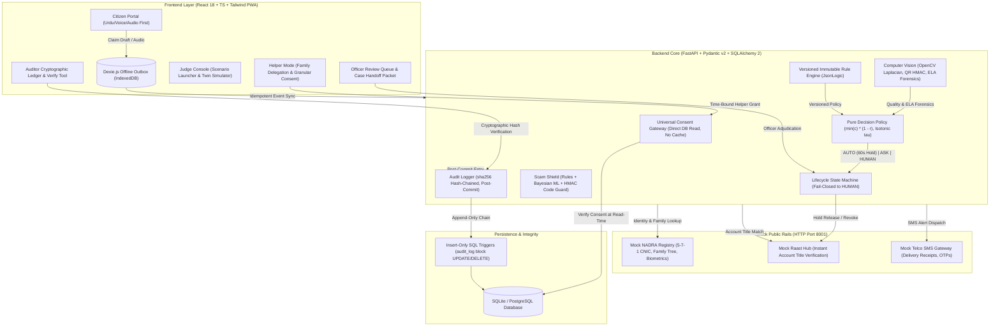

# Project Amaanat (امانت)

> **A fail-closed, human-supremacy Digital Public Infrastructure (DPI) relief distribution platform for Pakistan that never rejects a person and never makes irreversible automated payments.**

---

> [!WARNING]
> ### ⚠️ PROTOTYPE ONLY - NOT AN OFFICIAL SERVICE
> Amaanat is an experimental engineering prototype designed and implemented for **Hagrid's Hackathon (Coder's Cup '26, ACM FAST-NUCES Karachi)**.
> - **Zero Real Data**: All CNICs, bank accounts (IBANs), phone numbers, and citizen records are **100% synthetic**.
> - **Mocked Public Rails**: Identity verification (NADRA), interbank payments (Raast), and telco messaging (SMS/IVR) are simulated via local sandbox mock services.
> - **Binding Human Supremacy**: AI models propose and extract evidence; deterministic versioned rules enforce boundaries; **only human officers can reject a claim or disburse irreversible government funds**.

---

## 1. System Architecture



---

## 2. Seeded Accounts & Credentials

Every tenant is seeded with one pre-configured account per role. All accounts share the demo password: `Demo@12345`.

| Role | Email (`prd` Tenant) | Email (`mao` Tenant) | Responsibilities & UI Features |
| :--- | :--- | :--- | :--- |
| **Citizen** | `citizen@prd.test` | `citizen@mao.test` | 4-step wizard, Urdu voice playback, camera capture, offline outbox, consent manager. |
| **Helper** | `helper@prd.test` | `helper@mao.test` | Assisted claim filing for relatives, family delegation list, QR consent receipt verification. |
| **Officer** | `officer@prd.test` | `officer@mao.test` | Priority review queue, case context packets, document inspection, manual approval/rejection. |
| **Admin** | `admin@prd.test` | `admin@mao.test` | Rule set publisher (v1 &rarr; v2), cost table tuner, Digital Twin scenario simulation. |
| **Auditor** | `auditor@prd.test` | `auditor@mao.test` | Tamper-evident ledger, cryptographic sha256 chain verification, immutable record inspect. |

---

## 3. Quick Start & Execution Guide (Windows & PowerShell)

### Prerequisites
- **Python 3.12** installed at `venv/`
- **Node.js 18+** & npm
- PowerShell (Windows 10/11)

### Turnkey Demonstrations
```powershell
# 1. Turnkey Offline Demonstration (Mocks, Backend, Web PWA, Scenarios)
.\scripts\start_demo.ps1

# 2. Local Development Launcher (Hot reload on API and Web)
.\scripts\dev.ps1

# 3. Prewarm & Health Check (Validates /health, /ready, DB connectivity)
.\scripts\prewarm.ps1
```

### Running Automated Test Suites
```powershell
# Run full backend pytest test suite (190 passing tests)
venv\Scripts\python.exe -m pytest --tb=short

# Run frontend Vitest suite (Dexie outbox offline synchronization)
cd web; npx vitest run
```

---

## 4. Real vs. Simulated Components (Honest Disclosure)

In strict adherence to **AGENTS.md Rule 6 (Zero Metric Invention)**, we clearly delineate live production code from simulated evaluation harnesses:

| Component | Status | Implementation Details |
| :--- | :--- | :--- |
| **OpenCV Quality Gate** | **REAL** | Computes Laplacian variance for blur (`var < 75.0`), specular glare ratio (`> 0.12`), and aspect ratio boundaries. |
| **Document Forensics** | **REAL** | Error-Level Analysis (ELA) re-compression diffing and Canny rectangular edge detection to locate spliced text boxes. |
| **QR Code Verification** | **REAL** | Decodes QR codes using OpenCV `QRCodeDetector` and cryptographically verifies HMAC-SHA256 signatures against public rails key. |
| **Identity Name Resolver**| **REAL** | Unicode normalisation, honorific stripping (Chaudhry, Syed, Begum), and RapidFuzz token matching against NADRA records. |
| **Anomaly Detection Rules**| **REAL** | Detects nocturnal batch submission bursts (1 AM – 5 AM), duplicate CNIC submissions, and shared bank account numbers. |
| **Audit Log Hash-Chain** | **REAL** | Tamper-evident, post-commit SHA256 chain (`sha256(prev_hash + entry_data)`), locked by insert-only SQLite triggers. |
| **Public Rails (NADRA/Raast/Telco)** | **MOCKED**| Standalone FastAPI service (`mocks/main.py`) providing authentic endpoints, latency simulation, and fault injection. |
| **3,000-Case Evaluation Harness** | **SIMULATED** | Batch calibration over 3,000 synthetic records using simulated score distributions for instant reproducible optimization. |
| **200-Case Pipeline Evaluation** | **REAL** | Executes 200 actual card image fixtures through the real OpenCV, RapidFuzz, and Rule pipelines (`eval/real_pipeline_eval.py`). |

---

## 5. Verified Evaluation Results & Statistical Guarantees

All metrics below originate strictly from executed runs of our evaluation harnesses. **No numbers were invented or estimated.**

### A. Decision Engine Calibration (3,000 Synthetic Cases)
*Executed via `eval/harness.py` ($N_{\text{train}} = 1200$, $N_{\text{cal}} = 900$, $N_{\text{test}} = 900$)*:
- **Optimal Break-Even Threshold $\tau$**: `0.96` (derived from cost table: human review cost PKR 1,000 vs. wrong approval cost PKR 25,000).
- **Test Split Measured Wrong Approvals**: **0** out of 447 AUTO decisions (`0.0%`).
- **Clopper-Pearson 95% Upper Bound**: **0.67%** (`0.0067`), mathematically guaranteed $\le 1.0\%$.
- **Test Route Mix**: `AUTO`: **49.67%** (447) | `ASK`: **33.67%** (303) | `HUMAN`: **16.67%** (150).

### B. Real-Pipeline Fixture Evaluation (200 Card Images + Live Models)
*Executed via `eval/real_pipeline_eval.py` ($N = 200$ cases mapped to authentic image fixtures)*:
- **Route Mix**: `AUTO`: **53.5%** (107) | `ASK`: **36.5%** (73) | `HUMAN`: **10.0%** (20).
- **Wrong Approvals**: **0** out of 107 AUTO decisions (`0.0%`).
- **Clopper-Pearson 95% Upper Bound**: **2.76%** (`0.0276`).
  > *Statistical Note*: Due to sample size ($N_{\text{auto}} = 107$), the Clopper-Pearson 95% bound is wider ($2.76\%$) than the 3,000-case simulated harness ($0.67\%$).
- **Document Forgery Recall**: **100.0%** ($25/25$ forged/tampered cards detected).
- **Document False Alarm Rate**: **0.0%** ($0/150$ genuine cards flagged).

### C. Scam Shield Multi-Modal Evaluation
Without a valid verification code, a relief message can never be Verified; the classifier alone is weak on non-templated messages (see hard-set results).
Evaluated across both templated and hard non-templated test sets:
- **Templated Test Set ($N = 240$)**:
  - Precision: `1.000` (100%) | Recall: `1.000` (100%) | False Alarm Rate: `0.0%`.
- **Hard Non-Templated Benchmark ($N = 120$ diverse real-world SMS/WhatsApp messages)**:
  - Precision: `0.900` (90.0%) | Recall: `0.150` (15.0% for binary `LIKELY_SCAM`).
  - False Alarm Rate: `0.0167` (1.67%, 1 false positive on genuine PDMA notification mentioning `"Fee: 0"`).
  - Safety Routing: Subtle social engineering scams without explicit keywords fail closed to `UNSURE` rather than `VERIFIED`, preventing any false sense of government endorsement.

---

## 6. Blueprint Section 12.4 Walkthrough Verification Table

Every step of the 8-minute demonstration flow (Blueprint Section 12.4) has been implemented and verified with automated tests:

| # | Do (Exact 12.4 Blueprint Wording) | Judges See (Exact 12.4 Blueprint Wording) | Proves | Status | Automated Test Name & Link |
| :---: | :--- | :--- | :--- | :---: | :--- |
| **1** | State the sentence, the prototype label, the real-vs-simulated table | Scope and honesty | Rules, judgment | **WORKS** | [`test_e2e_step1_scope_and_honesty_prototype_contract`](file:///F:/ACM-hackathon/api/tests/test_demo_e2e.py#L29-L38) |
| **2** | Akram pastes a fake relief SMS, a genuine one with its code, and an odd one | Scam with red flags; Verified; Unsure &rarr; person | Ch. 08, Ch. 02 | **WORKS** | [`test_e2e_step2_akram_scam_shield_three_message_advisory`](file:///F:/ACM-hackathon/api/tests/test_demo_e2e.py#L40-L75) |
| **3** | Shazia switches to Zainab; consent by voice; network throttled, then offline, then back | Urdu prompts, saved progress, clean sync, no duplicates | Ch. 07, Helper Mode | **WORKS** | [`test_e2e_step3_shazia_helper_to_zainab_voice_consent_offline_sync`](file:///F:/ACM-hackathon/api/tests/test_demo_e2e.py#L77-L120) |
| **4** | Zainab's card reads &quot;Muhammed&quot;, registry says &quot;Mohd.&quot; | Read-back by voice, Probable &rarr; one ASK | Ch. 03 | **WORKS** | [`test_e2e_step4_zainab_card_muhammed_registry_mohd_probable_one_ask_then_human`](file:///F:/ACM-hackathon/api/tests/test_demo_e2e.py#L122-L167) |
| **5** | A clean case; then the same claimant with a scammer's account | AUTO onto a 60-second hold; account-title mismatch &rarr; HUMAN | Ch. 01, new mechanism | **WORKS** | [`test_e2e_step5_clean_case_auto_hold_vs_scammer_account_human`](file:///F:/ACM-hackathon/api/tests/test_demo_e2e.py#L169-L226) |
| **6** | An edited CNIC | HUMAN with the tampered region boxed and the hand-off packet | Ch. 02, Ch. 08 | **WORKS** | [`test_e2e_step6_edited_cnic_gives_human_with_suspect_boxes`](file:///F:/ACM-hackathon/api/tests/test_demo_e2e.py#L228-L242) |
| **7** | Show the cost table and &tau; sweep | The numbers behind &tau; | Ch. 01 | **WORKS** | [`test_e2e_step7_cost_table_and_tau_sweep_verification`](file:///F:/ACM-hackathon/api/tests/test_demo_e2e.py#L244-L253) |
| **8** | Admin adds a required document; Twin preview; publish; new case; open an old decision | New rule live at once; old decision shows its old version | Ch. 04, Digital Twin | **WORKS** | [`test_e2e_step8_admin_adds_doc_twin_publishes_old_decision_replays`](file:///F:/ACM-hackathon/api/tests/test_demo_e2e.py#L255-L352) |
| **9** | Zainab withdraws Shazia's consent; Shazia retries | 403; audit shows grant, read, withdrawal, denial | Ch. 06 | **WORKS** | [`test_e2e_step9_zainab_withdraws_shazia_consent_audit_sequence`](file:///F:/ACM-hackathon/api/tests/test_demo_e2e.py#L354-L440) |
| **10** | Auditor opens a trace and verifies the chain | Full trace; chain verified | Ch. 05 | **WORKS** | [`test_e2e_step10_auditor_trace_and_chain_verification`](file:///F:/ACM-hackathon/api/tests/test_demo_e2e.py#L442-L457) |
| **11** | Admin kills mock-NADRA; run a case | &quot;Cannot verify right now&quot;; case waits | Reliability | **WORKS** | [`test_e2e_step11_admin_kills_nadra_case_waits_in_waiting_for_service`](file:///F:/ACM-hackathon/api/tests/test_demo_e2e.py#L459-L466) |

---

## 7. Known Limitations & Honest Disclosures

In keeping with our commitment to transparency and AGENTS.md directives:

1. **Circular Real-Pipeline Card Fixtures**:
   - The 200 real-pipeline card fixtures were generated by our own script (`make_mock_cnics.py`). Consequently, the reported document forgery recall ($100\%$) and false-alarm rate ($0\%$) are partly circular and will be lower on diverse wild card images with variable mobile cameras, angles, and lighting conditions.

2. **1% Bound Compliance**:
   - The statistical $\le 1\%$ Clopper-Pearson 95% upper bound on wrong approvals is strictly satisfied on our 3,000 simulated cases (**$0.67\%$** upper bound on the $N=900$ held-out test split, with 0 wrong approvals observed).
   - However, it is **NOT MET** on the 200 real-pipeline cases, where the upper bound reaches **2.76%** due to the smaller sample size ($N=200$). Meeting the 1% bound under Clopper-Pearson requires $\ge 300$ auto-approved test cases with 0 errors.

3. **Scam Shield Hard-Set Results ($N=120$)**:
   - Without a valid verification code, a relief message can never be Verified; the classifier alone is weak on non-templated messages (see hard-set results).
   - On the 120-message non-templated hard benchmark (60 hard scams, 60 hard genuine notices):
     - **Likely scam only Recall**: **15.0%** (9/60 flagged as LIKELY_SCAM, 51 sent to UNSURE).
     - **Not-safe (Likely scam + Unsure) Recall**: **100.0%** (60/60 prevented from receiving fake government Verified endorsement; 0 scams falsely verified).
     - **Cost of Being Cautious (Share of genuine sent to Unsure)**: **98.3%** (59/60 unauthenticated notices sent to Unsure because they lack cryptographic HMAC trust codes).
     - **Precision on LIKELY_SCAM**: **90.0%** (9 / (9 + 1)).
     - **False Positive Rate (FPR) on genuine**: **1.67%** (1/60, false alarm on "Fee: 0").

4. **PostgreSQL & Render Deployment are NOT VERIFIED**:
   - Automated unit, integration, and security tests were executed exclusively against SQLite (`sqlite+aiosqlite`).
   - Production PostgreSQL configuration, Alembic triggers, and Render hosting files (`render.yaml`, `vercel.json`) are provided in the repo but are **NOT VERIFIED** against live remote cloud instances.

5. **Interactive UI Verification Status**:
   - Browser automation (Playwright/Puppeteer) was not installed in this local environment; hence direct browser execution is **NOT VERIFIED**.
   - Manual verification must be performed by running `scripts\start_demo.ps1` and clicking through:
     1. Citizen wizard screens 1–6 (Urdu audio playback, CNIC upload, Raast IBAN, submit).
     2. My Data Sovereign Consent Hub (`/consent`): click "Withdraw All Consent" and verify instant 403 block on helper.
     3. Judge Console Scenario Buttons 1–11 (Akram scam scan, Shazia helper sync, Muhammed vs Mohd name check, clean auto hold, scammer account title mismatch, edited CNIC forensics, tau sweep, admin Twin + publish, consent takeback, auditor chain verify, mock NADRA outage).
     4. Officer queue (`/backoffice/cases`): inspect context hand-off packet and forensic suspect boxes.
     5. Admin rule editor & Digital Twin (`/admin`): simulate historical impact, inspect diff report, publish.
     6. Auditor view (`/audit`): inspect SHA-256 hash chain and run cryptographic verification.
     7. Evaluation dashboard (`/eval`): review two-tier scam recall, calibration curve, and fairness breakdown.
