# Amaanat — Operational Clickthrough & Demonstration Guide

> **PROTOTYPE ONLY**: Hackathon Prototype for Hagrid's Hackathon (Coder's Cup '26). Not an official government service. All data is synthetic.  
> **Source of Truth**: `docs/BLUEPRINT.md` Section 12.4.  
> **Relief Grant Amount**: **PKR 25,000** (standardized across all UI text, code, and test fixtures).

---

## 1. Application Layout & Access Credentials

The Amaanat web application is an offline-capable React 18 + TypeScript PWA served at `http://localhost:5173`.  
Top navigation bar provides instantaneous switching across four primary views (`AppView` in `web/src/App.tsx`):
1. **Citizen Claim** (`citizen`): Accessible mobile-optimized citizen onboarding flow (Screens 1–6) and Sovereign Consent Hub (`MyData`).
2. **Back-Office** (`backoffice`): Administrative console featuring role-swapping, Officer Queue, Admin & Digital Twin, Auditor Ledger, and Transparent Evaluation Dashboard.
3. **Judge Console** (`judge`): Dual-pane presentation console featuring an interactive mobile device emulator side-by-side with back-office operations and 5 one-click scenario seeders.
4. **Helper Mode** (`helper`): Community intermediary dashboard for assisted family onboarding with PIN delegation and automated idle timeout.

### Seeded Credentials (Tenant `prd`)
Every role can be switched with one click using the `<RoleSelector />` in the Back-Office header, or by logging in via the API:
- **Citizen**: `citizen@prd.test` / `Demo@12345`
- **Helper**: `helper@prd.test` / `Demo@12345`
- **Officer**: `officer@prd.test` / `Demo@12345`
- **Admin**: `admin@prd.test` / `Demo@12345`
- **Auditor**: `auditor@prd.test` / `Demo@12345`

---

## 2. Blueprint Section 12.4 Step-by-Step Demonstration Walkthrough

Follow this exact sequence to demonstrate each required step from Blueprint Section 12.4.

```mermaid
flowchart LR
    S1["1. Scope & Honesty"] --> S2["2. Scam Shield Scan"]
    S2 --> S3["3. Helper & Voice Consent"]
    S3 --> S4["4. Name Variant 1-ASK"]
    S4 --> S5["5. Clean Case vs Scammer"]
    S5 --> S6["6. Forged CNIC Forensics"]
    S6 --> S7["7. Cost Table & Tau Sweep"]
    S7 --> S8["8. Digital Twin & Publish"]
    S8 --> S9["9. Sovereign Consent Takeback"]
    S9 --> S10["10. Auditor Cryptographic Chain"]
    S10 --> S11["11. Mock Rails Chaos & Fail-Closed"]
```

---

### Step 1: Scope, Honesty & Prototype Contract
- **View**: Top Bar & Any Screen (`All Views`)
- **Login**: Any / Public
- **What Screen Shows**:
  - Prominent red/amber banner at top of every screen: `PROTOTYPE ONLY — Hagrid's Hackathon 2026. Not an official government service. All data is synthetic.`
  - Footer: `Project Amaanat (امانت) — Fail Closed to HUMAN — Zero Real Personal Data`.
- **Button Sequence**:
  1. Open `http://localhost:5173`.
  2. Point to the top fixed `<PrototypeBadge />` banner and footer disclaimer.
  3. Switch to **Back-Office** tab &rarr; Click **Evaluation Dashboard** (`/eval/latest`) tab to display the real vs. simulated pipeline disclaimer.

---

### Step 2: Akram Pastes SMS into Scam Shield (Fake, Genuine, Odd)
- **View**: **Citizen Claim** (`view === 'citizen'`) &rarr; Screen 2
- **Login**: `citizen@prd.test`
- **What Screen Shows**:
  - Urdu/English advisory heading: *"میسج چیک کریں / Scan Message for Fraud"*.
  - Text input area with advisory notice: *"Without a valid verification code, a relief message can never be Verified; the classifier alone is weak on non-templated messages."*
- **Button Sequence**:
  1. Click **Citizen Claim** in top bar.
  2. On Screen 1, click **"درخواست شروع کریں / Start Claim"** to navigate to Screen 2.
  3. **Message A (Fake Scam)**:
     - Paste: `"Amaanat Relief: Your grant of PKR 25,000 is ready. Deposit PKR 1,500 registration fee via JazzCash to 03001234567 to release."`
     - Click **"میسج چیک کریں / Scan Message"**.
     - Result: Red banner `LIKELY_SCAM` with warning: *"Demands advance fees via digital wallet. Official programs never charge registration fees."*
  4. **Message B (Genuine with HMAC Code)**:
     - Paste: `"Amaanat Relief: Grant PKR 25,000 approved for CNIC 42101-1000001-1. Ref: 8F3A2B-PRD. Verify at amaanat.pk/v/9A3C2E1F8B"` (where HMAC verifies).
     - Click **"میسج چیک کریں / Scan Message"**.
     - Result: Green banner `VERIFIED` with trust badge.
  5. **Message C (Odd Message without Code)**:
     - Paste: `"Urgent: Flood relief grant distribution starts tomorrow at central camp. Bring original documents."`
     - Click **"میسج چیک کریں / Scan Message"**.
     - Result: Amber banner `UNSURE` with advisory: *"Fails closed. Without an authenticated verification code, this message cannot be verified. Check in person."*
  6. Click **"آگے بڑھیں / Continue to Application"** to proceed to Screen 3.

---

### Step 3: Shazia Switches to Zainab; Voice Consent; Throttled / Offline Sync
- **View**: **Helper Mode** (`view === 'helper'`) & **Citizen Claim** (`view === 'citizen'`)
- **Login**: `helper@prd.test`
- **What Screen Shows**:
  - Helper Mode Family Cards: Tariq Family, Akram Family, Bibi Family.
  - Urdu audio playback prompt: *"کیا آپ ریلیف گرانٹ کی جانچ کے لیے رضامندی دیتے ہیں؟"*
  - Online/Offline connectivity pill in header (`آن لائن / آف لائن`).
- **Button Sequence**:
  1. Click **Helper Mode** in top bar.
  2. Click on **"Zainab Bibi (خاندان)"**.
  3. Modal requests 4-digit delegation PIN: enter `1234` on `<Keypad />`.
  4. Switch view to **Citizen Claim** (Screen 3: Universal Consent Gate).
  5. Click Urdu audio speaker icon: voice prompts for consent.
  6. Say *"ہاں"* (or click **"میں رضامند ہوں / I Give Consent"**).
  7. Open browser DevTools &rarr; Network &rarr; check **Offline** (or disconnect Wi-Fi).
  8. Notice header pill immediately turns red: `آف لائن (محفوظ ہو رہا ہے)`.
  9. Click through Screen 4 (capture front & back photos & click **"تصاویر اپ لوڈ کریں / Upload & Proceed"**).
  10. Re-enable network in DevTools: header pill displays green `آن لائن`, and Dexie outbox background queue syncs stored events to `/api/v1/sync/push` without duplicate creation.

---

### Step 4: Zainab Card "Muhammed", Registry "Mohd." (1-ASK Round)
- **View**: **Back-Office** &rarr; **Officer Queue**
- **Login**: `officer@prd.test`
- **What Screen Shows**:
  - Case review details showing Name Similarity score `0.85` (Probable band [0.75, 0.92)).
  - Decision route: `ASK` (Target: `clarify_name_variant`).
  - Strict policy check: Exactly 1 ASK round permitted for identity variations before escalating to HUMAN.
- **Button Sequence**:
  1. Click **Back-Office** &rarr; select **Officer Queue** tab.
  2. Locate submitted case with claimant `"Muhammed Bibi"` against NADRA registry `"Mohd Bibi"`.
  3. Inspect policy trace: `identity_match_exact: false`, raw lexical distance `< 0.92`, canonical dictionary match `= true` &rarr; similarity assigned `0.85`.
  4. Notice system status: `NEEDS_INFO` (Round 1: ASK).
  5. Click **"Request Missing Info (ASK)"**: system issues single clarification request.
  6. If clarification is unresolved or re-submitted without match, subsequent evaluation immediately routes to `HUMAN` review (never a 2nd ASK round).

---

### Step 5: Clean Case (AUTO 60s Hold) vs. Scammer Account (HUMAN)
- **View**: **Judge Console** (`view === 'judge'`)
- **Login**: `officer@prd.test`
- **What Screen Shows**:
  - Live 60-second reversible hold countdown ribbon in header with `Release Now` and `Reverse Hold` buttons.
  - Officer Queue displaying case hand-off packets.
- **Button Sequence**:
  1. Click **Judge Console** in top bar.
  2. Click Scenario Button 1: **"1. Clean Case (AUTO 60s Hold)"**.
     - Left mobile pane shows Screen 6: Green badge `APPROVED_ON_HOLD`.
     - Top ribbon displays: `Reversible Release Hold: 60s` counting down live.
     - Click **"Reverse Hold"** (or **"Release Now"** to confirm instant Raast payout).
  3. Click Scenario Button 2: **"2. Scammer Account (HUMAN)"**.
     - Left mobile pane updates: routes to `IN_REVIEW`.
     - Right officer pane displays Case Hand-off Packet:
       - Hard guard failure: `account_title_matches_claimant: false`.
       - Claimant: `MUHAMMAD TARIQ` | Bank Account Holder: `ASIF ALI (Scammer Account)`.
       - Disallowed from AUTO payout; securely routed to officer for fraud inspection.

---

### Step 6: Forged CNIC (ELA Forensic Suspect Boxes & Officer Packet)
- **View**: **Judge Console** &rarr; Scenario 3, or **Back-Office** &rarr; **Officer Queue**
- **Login**: `officer@prd.test`
- **What Screen Shows**:
  - Uploaded CNIC front preview overlaid with bright yellow/red Error Level Analysis (ELA) suspect bounding boxes where digits were spliced.
  - Context hand-off packet with authenticity score (`< 0.60`).
- **Button Sequence**:
  1. In **Judge Console**, click Scenario Button 3: **"3. Forged CNIC (HUMAN)"**.
  2. In the right Back-Office pane, open the flagged case.
  3. Observe the CNIC image viewer:
     - Notice the suspect bounding box around the spliced CNIC expiry date and family tree number.
     - Hand-off packet specifies: `"ELA high-frequency gradient anomaly detected in document header"`.
  4. Officer inspects evidence and clicks red button **"Reject (Officer Supremacy)"** with note: *"Document tampered. Human officer confirmed forgery."* (Proves: AI never rejects; only human officer has authority to reject).

---

### Step 7: Show Cost Table & Tau Sweep ($\tau = 0.96$)
- **View**: **Back-Office** &rarr; **Evaluation Dashboard** (`/eval/latest`)
- **Login**: `auditor@prd.test` or `admin@prd.test`
- **What Screen Shows**:
  - Published Rule Set Cost Table:
    - Wrong Approval Cost ($C_{FA}$): `100` units (PKR 25,000)
    - Human Review Cost ($C_{Rev}$): `4` units (PKR 1,000)
    - Ask Round Cost ($C_{Ask}$): `1` unit (PKR 250)
  - Mathematical Derivation:
    $$\tau = 1 - \frac{C_{Rev}}{C_{FA}} = 1 - \frac{4}{100} = 0.96$$
  - Tau Sweep Cost Curve: plot showing expected operational cost per case across thresholds $\tau \in [0.80, 0.99]$, with minimum cost achieved at $\tau = 0.96$.
- **Button Sequence**:
  1. Click **Back-Office** in top bar.
  2. Click **Role Selector** &rarr; select **Auditor**.
  3. Click **Evaluation Dashboard** tab.
  4. Point to the **Decision Engine Policy Calibration** card:
     - Highlight $\tau = 0.96$ break-even derivation.
     - Highlight Clopper-Pearson 95% upper bound on wrong approvals: `0.67% <= 1.00%`.

---

### Step 8: Admin Adds Required Document; Digital Twin; Publish; Historical Replay
- **View**: **Back-Office** &rarr; **Admin & Digital Twin**
- **Login**: `admin@prd.test`
- **What Screen Shows**:
  - Rule Editor: thresholds, required documents (`cnic_front`, `residence_certificate`), and auto-approval cap (PKR 25,000).
  - Digital Twin Simulation: sample size selector (`N = 100`), projected route mix shift, and estimated operational cost delta.
- **Button Sequence**:
  1. Click **Back-Office** &rarr; select **Admin & Digital Twin** tab.
  2. In the Rule Configuration editor, add required document: `"residence_certificate"`.
  3. Click **"Run Digital Twin Simulation"**:
     - System runs 100 historical cases through draft rule definition.
     - Displays Twin Diff Report: `Auto-approval rate shifts from 68% -> 44%; ASK rounds increase for missing residence certificate`.
  4. Click green button **"Publish Rule Set Version"**:
     - Immediately deploys new immutable rule version $V_{N+1}$ with zero server restart.
  5. Submit a new case lacking `residence_certificate`: evaluate endpoint immediately routes to `ASK` for the new document.
  6. Switch to **Auditor Ledger** tab &rarr; select a historic decision from $V_1$: click **"Replay Decision"** &rarr; system replays stored `input_snapshot` against historical $V_1$ content hash, returning `matches: true`.

---

### Step 9: Zainab Withdraws Shazia's Consent; Shazia Retries (403); Audit Trail
- **View**: **Citizen Claim** &rarr; **My Data** (`/consent`), followed by **Helper Mode**
- **Login**: `citizen@prd.test` then `helper@prd.test`
- **What Screen Shows**:
  - My Data Sovereign Consent Hub: 4 toggle scopes (Identity, Contact, Documents, Payment).
  - Red **"Withdraw All Consent"** button.
  - Helper Mode: Bibi Family showing `CONSENT_REVOKED`.
- **Button Sequence**:
  1. In **Citizen Claim**, click the **Database Icon** in the top right header to open `<MyData />`.
  2. Click red button **"تمام رضامندی واپس لیں / Withdraw All Consent"**.
     - Message displays: *"تمام رضامندی کامیابی سے منسوخ کر دی گئی ہے / All consent revoked successfully."*
  3. Switch view to **Helper Mode** (`view === 'helper'`).
  4. Helper attempts to click on **"Bibi Family (بی بی خاندان)"**.
  5. UI immediately displays red error banner:
     `HTTP 403 Forbidden: Citizen has withdrawn consent. Helper access is strictly blocked.`
  6. Switch to **Back-Office** &rarr; **Auditor Ledger** tab:
     - Audit log shows chronological sequence:
       `consent.granted` &rarr; `consent.read` &rarr; `consent.withdrawn` &rarr; `consent.denied_withdrawn`.

---

### Step 10: Auditor Opens Trace and Verifies Cryptographic Hash Chain
- **View**: **Back-Office** &rarr; **Auditor Ledger** (`/audit`)
- **Login**: `auditor@prd.test`
- **What Screen Shows**:
  - Immutable, hash-chained audit log table: `id`, `timestamp`, `actor_id`, `action`, `entity_type`, `sha256_current`, `prev_hash`.
  - Green verification banner: `Audit Chain Verified Intact (SHA-256 Link Valid)`.
- **Button Sequence**:
  1. Click **Back-Office** in top bar &rarr; select **Auditor Ledger** tab.
  2. Inspect the audit table: point out that each row's `prev_hash` strictly equals the preceding row's SHA-256 hash.
  3. Click blue button **"Verify Chain Integrity"**:
     - System calls `GET /api/v1/audit/verify`.
     - Displays verification result: `ok: true`, `total_verified_entries: 140+`, `broken_at_id: null`.
  4. Click on any decision entry to inspect the full immutable context packet, isotonic calibration score $p$, threshold $\tau$, and model prompt version.

---

### Step 11: Admin Kills Mock-NADRA; Run Case &rarr; "Cannot verify right now"
- **View**: **Back-Office** &rarr; **Admin & Digital Twin** &rarr; **Chaos Controller**
- **Login**: `admin@prd.test` then `officer@prd.test`
- **What Screen Shows**:
  - Live mock rails failure injection switches: `NADRA 500 Error`, `NADRA Latency`, `Raast Timeout`, `SMS Failure`.
  - Case status: `WAITING_FOR_SERVICE`.
  - Citizen explanation: *"Cannot verify right now. External service is temporarily unavailable; case is waiting for service recovery."*
- **Button Sequence**:
  1. In **Back-Office**, select **Admin & Digital Twin** &rarr; switch to **Chaos** tab.
  2. Toggle **NADRA 500 Internal Error** to `ON` (calls `POST /api/v1/admin/chaos` with `service="nadra", error_500=true`).
  3. Switch to **Citizen Claim** and submit a new application (or trigger Scenario 5 in **Judge Console**).
  4. Switch to **Officer Queue**: click **"Evaluate / Decide"** on the case.
  5. The API catches the simulated outage, prevents any decision, and assigns status: `WAITING_FOR_SERVICE`.
  6. Citizen reason plainly displays:
     *"Cannot verify right now. External service is temporarily unavailable; case is waiting for service recovery."*
  7. Return to **Admin Chaos** tab &rarr; click **"Reset All Chaos"** &rarr; NADRA service returns to healthy operational state.

---

## 3. Summary of Automated Verification Tests

Every single manual clickthrough step detailed above is backed by a corresponding automated test in `api/tests/test_demo_e2e.py` executing over real HTTP endpoints:

| Blueprint Step | Automated Test |
| :--- | :--- |
| **Step 1: Prototype Label & Contract** | `test_e2e_step1_scope_and_honesty_prototype_contract` |
| **Step 2: Akram Scam Shield Scan** | `test_e2e_step2_akram_scam_shield_three_message_advisory` |
| **Step 3: Helper Sync & Voice Consent** | `test_e2e_step3_shazia_helper_to_zainab_voice_consent_offline_sync` |
| **Step 4: Name Variant 1-ASK** | `test_e2e_step4_zainab_card_muhammed_registry_mohd_probable_one_ask_then_human` |
| **Step 5: Clean Auto Hold vs. Scammer** | `test_e2e_step5_clean_case_auto_hold_vs_scammer_account_human` |
| **Step 6: Edited CNIC Forensics** | `test_e2e_step6_edited_cnic_gives_human_with_suspect_boxes` |
| **Step 7: Cost Table & Tau Sweep** | `test_e2e_step7_cost_table_and_tau_sweep_verification` |
| **Step 8: Admin Twin & Rule Publish** | `test_e2e_step8_admin_adds_doc_twin_publishes_old_decision_replays` |
| **Step 9: Consent Takeback (403)** | `test_e2e_step9_zainab_withdraws_shazia_consent_audit_sequence` |
| **Step 10: Auditor Hash Chain** | `test_e2e_step10_auditor_trace_and_chain_verification` |
| **Step 11: Mock Rail Chaos Outage** | `test_e2e_step11_admin_kills_nadra_case_waits_in_waiting_for_service` |
| **Multi-ASK Blurry Photo (Max 2)** | `test_e2e_multi_ask_blurry_photo_twice_then_human` |
